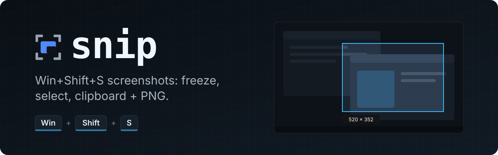
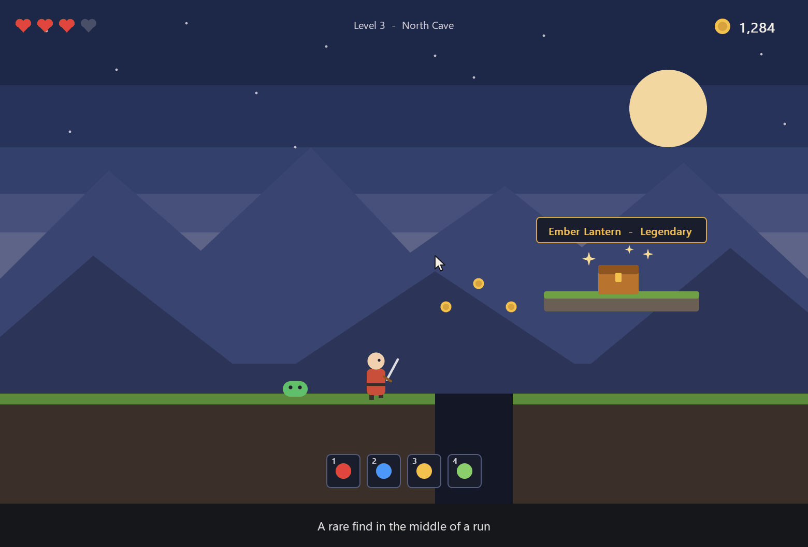
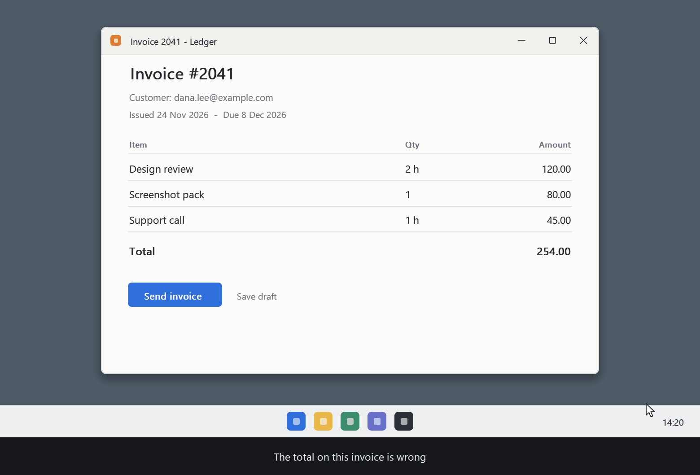
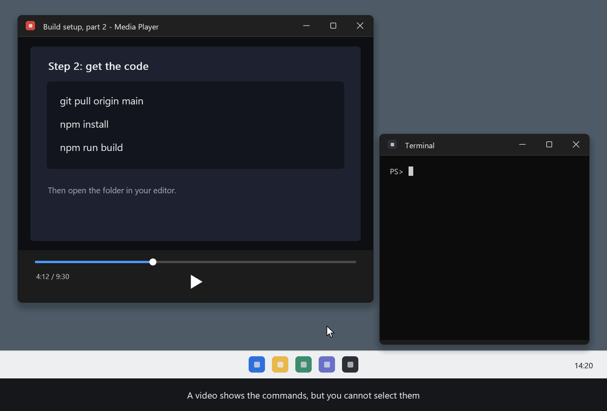
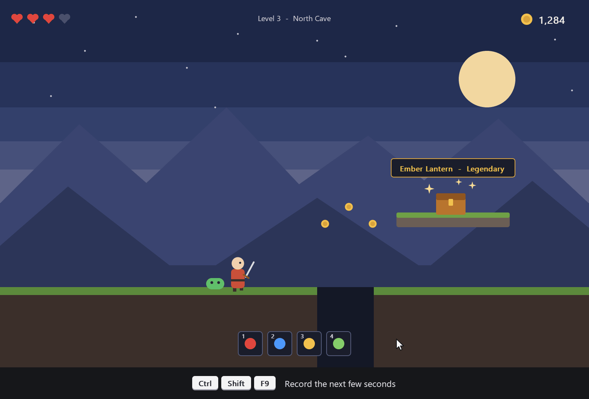
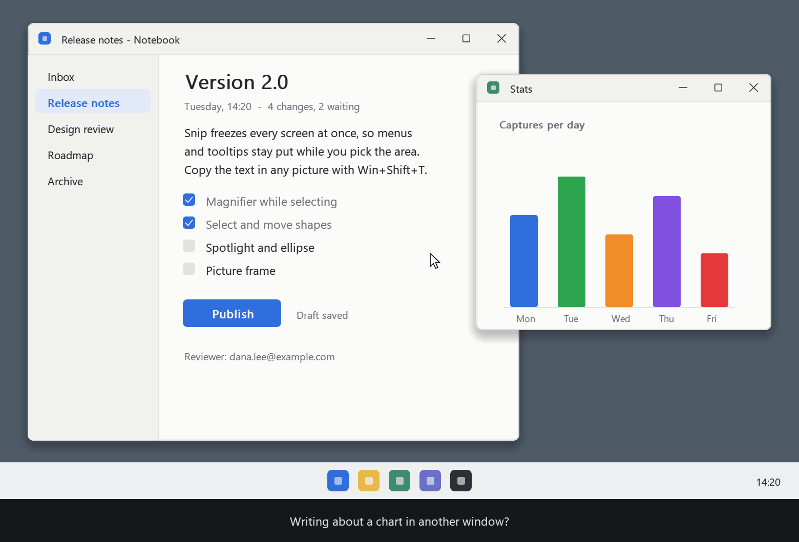
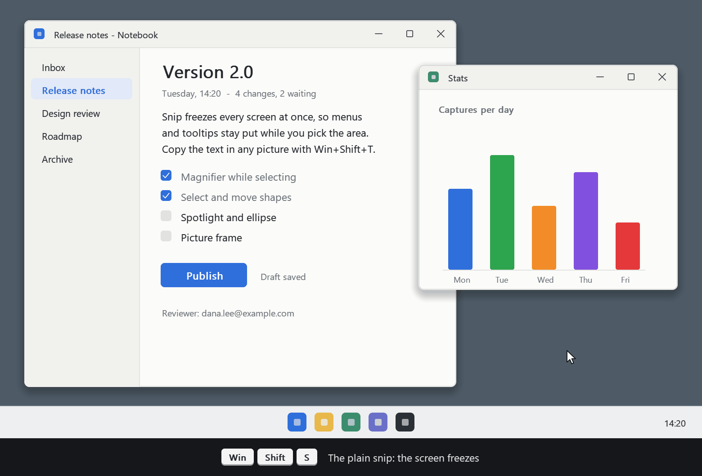
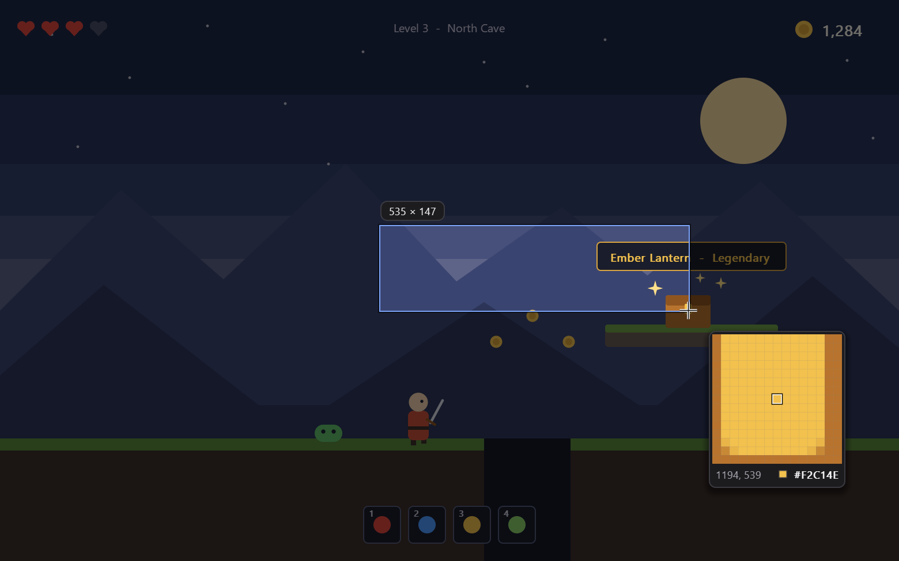

<p align="center"></p>

# snip

A small screenshot tool for Windows 11, written in Rust. It sits in the tray. Press a key and every
screen freezes; pick an area or a window, mark it up, and it is on the clipboard, ready to paste.
It also copies text out of pictures, records short clips and pins a picture on top of your work.

No account, no updater, no network code. One small exe.

[Download the latest release](https://github.com/ydbilgin/snip/releases/latest) ·
[Keys](#keys) · [Install](#install) · [Privacy](#privacy) · [Build](#build) · [Türkçe](#türkçe)

> **Beta, unsigned.** The exe is not code-signed, so Windows SmartScreen may warn on first start
> ("More info" > "Run anyway"). Each release lists the SHA-256 of the exe so you can check it, or
> build it yourself from this source.

## Share a moment from a game

A rare find, a funny glitch, a score: press **Pause** and the frame freezes, so nothing moves while
you pick it. Circle it, write where it is, **Ctrl+C**, and paste it in the chat.

<p align="center">
  
</p>

## Report a bug with a picture that explains itself

Click a window to take all of it. An arrow and a few words show what is wrong; pixelate the email
or the name that should not travel. Paste it straight into the issue.

<p align="center">
  
</p>

## Copy code from a paused video

Tutorials, slides and error dialogs show text you cannot select. **Win+Shift+T**, drag over it, and
the text is on the clipboard. The OCR that ships with Windows reads it, on your PC; no picture is
kept.

<p align="center">
  
</p>

The text in this film was read by the Windows OCR from the film's own frame when it was made.

## Record the next few seconds

**Ctrl+Shift+F9**, pick the area, and snip records a silent MP4 at 30 frames a second, plus a GIF
made from it for a chat or a bug report. The red bars and the timer stay outside the clip; the same
key stops it.

<p align="center">
  
</p>

## Keep a reference on top while you work

**Ctrl+P** in the editor pins the picture above every window. Write about a chart, copy a design,
follow steps: the pin stays where you put it. Drag it anywhere, the wheel zooms, Esc closes it.

<p align="center">
  
</p>

## Keys

| Key | What happens |
|---|---|
| **Win+Shift+S** | Plain snip: drag an area, click a window, or Enter for the whole screen. Straight to the clipboard and a PNG |
| **PrtScn** | Every screen as one picture, no overlay |
| **Pause** | Snip and edit: pick an area or a window, then draw on it |
| **Win+Shift+T** | Copy text: drag over it |
| **Ctrl+Shift+F9** | Start and stop a short recording |

Every key can be changed or turned off in Settings. Win+Shift+R stays with Snipping Tool.
[All keys](#all-keys) are further down.

<p align="center">
  
</p>

## What is in it

| | |
|---|---|
| **Capture** | Area, window (a click), a part inside a window (Alt or the wheel), the whole screen, all screens; every monitor frozen at once, so menus and tooltips stay put |
| **Editor** | Arrow, box, ellipse, line, pen, highlighter, text, numbered steps, spotlight, pixelate and blur; pick a shape again to move or delete it; a colour picker; a magnifier while picking; **Frame** puts the picture on a calm ground with a soft shadow |
| **Out** | Copy, save, save as or pin |
| **Text** | Copy text out of any picture with the Windows OCR |
| **Recording** | A silent MP4 and a GIF from it |
| **History** | The last 50 pictures (also those only copied); the main window (`snip home`) keeps the last 20 copied texts |
| **Settings** | Keys, what happens after a capture, two designs in light and dark, English and Turkish |

<table>
  <tr>
    <td width="50%"><br>
      The magnifier while you pick the area: a pixel grid, the position and the colour under the cursor.</td>
    <td width="50%"><br>
      The toolbar sits beside the area and wraps into rows on a small screen.</td>
  </tr>
  <tr>
    <td width="50%"><br>
      History: copy, pin or delete a recent capture again.</td>
    <td width="50%"><br>
      Settings: every key can be changed or turned off.</td>
  </tr>
</table>

## Install

| Step | |
|---|---|
| 1 | Download `snip-<version>-windows-x64.zip` from the [latest release](https://github.com/ydbilgin/snip/releases/latest) and unzip it |
| 2 | Run `snip.exe`. A tray icon appears and Win+Shift+S now goes to snip. `snip quit` (or Quit in the tray menu) gives it back to Windows |
| 3 | Optional: `install\install.ps1` copies the exe to `%LOCALAPPDATA%\Programs\snip`; `install.ps1 -RunAtLogon` (elevated) installs it to `%ProgramFiles%\snip` and starts it at logon ([why](#why-it-can-run-elevated)). `install\uninstall.ps1` removes either |

Windows 11 on x64. Recording needs the Windows Media Feature Pack (present on most editions).
Text capture uses the OCR languages installed in Windows (Settings > Time & language > Language).

## All keys

| Key | What happens |
|---|---|
| **Win+Shift+S** | Plain snip: drag a region, click a window, Enter for the monitor under the cursor (Shift+Enter without its taskbar) |
| **Shift+click** / **Shift+drag** | Add a window or region to the same picture; Backspace removes the last one |
| Tap **Alt** or use the **wheel** | Pick a part inside a window (a panel, a button, a list) |
| **PrtScn**, **Win+Shift+PrtScn** | All screens as one picture |
| **Pause** | Snip and edit. In the editor: Ctrl+C copy, Ctrl+S save, Ctrl+Shift+S save as, Ctrl+P pin |
| Editor tools | V select, A arrow, R box, E ellipse, L line, P pen, H highlighter, T text, N steps, F spotlight, B pixelate, I colour picker; 1/2/3 or the wheel for size; Ctrl+Z / Ctrl+Y |
| With a shape selected (V) | Drag to move, arrow keys to nudge (Shift: 10 px), Delete to remove |
| **Win+Shift+T** | Copy text: drag over it |
| **Ctrl+Shift+F9** | Start and stop a recording |
| **Arrow keys** | Move the cursor by 1 px (10 px with Shift) |
| **Esc** or right-click | Cancel |
| Hold **Alt** while dragging | Let a drag cross to another monitor |

## Privacy

- **No network.** snip has no network code; a test (`tests/no_network.rs`) fails if the sources or
  the dependency list ever gain anything network-shaped.
- **Files it writes:** your pictures (Screenshots folder, or the folder you choose); settings in
  `%APPDATA%\Laureth\snip\config.toml`; a step-timing log, state and the history thumbnails in
  `%LOCALAPPDATA%\Laureth\snip\`. The log holds sizes, times and the paths of saved files, never
  screen contents or clipboard text.
- **History:** the last 50 pictures (also ones that were only copied) and the last 20 copied texts
  are kept in that folder so you can find them again. Turn history off in Settings to keep nothing.
- **Clipboard:** snip writes pictures and text; it reads the clipboard only to confirm its own
  write and to avoid overwriting something newer.
- **Keyboard:** a low-level keyboard hook in snip's own process reacts only to its own keys. It does
  not record keystrokes.

## Why it can run elevated

A keyboard hook gets no key events while an elevated window (an administrator terminal, Task
Manager) has the focus, so Win+Shift+S would do nothing there. With `install.ps1 -RunAtLogon`, snip
starts at the highest level through a scheduled task, from `%ProgramFiles%\snip`, a folder only
administrators can change. Anything it opens (a folder, a saved picture) is started at the normal
level with the shell's own token. If you do not need the keys above elevated windows, just run the
exe; it works at the normal level.

## Build

You need Windows 11, Rust 1.97 or newer and the MSVC toolchain with the Windows SDK (for `rc.exe`;
set `RC` to its path if it is not on `PATH`).

```powershell
cargo build --release
cargo test
target\release\snip.exe --selftest   # headless checks, exit 0 = all passed
```

The core (geometry, editor, renderer, history, settings) has no Windows calls, so `cargo test` also
runs on Linux. Tests that open windows (`--selftest-overlay`, `--selftest-look`, ...) refuse the
visible desktop and must run on a separate hidden desktop.

**How the films are made.** They are not screen recordings. `snip --demo-gif DIR` runs a script
per story over made-up screens at 150 % scale (apps on a desktop, and a game drawn from flat shapes
for these films) and draws every frame with the app's own code: the editor is the real editor fed
with scripted mouse and key events; the plain, text and recording overlays are drawn from the same
pieces the overlay window shows (mode bar, hints, labels, frame, card, recording control). The
copy-code film's words come from the Windows OCR reading that frame. No window opens, the screen is
not read and no input is sent. The strip under each film (keys and a sentence) is narration, not
part of snip, and so are the apps the pictures are pasted into. Change the UI, run it again, and
the README shows the new look.

For scripts: `snip status`, `snip snip [--edit] [--delay 3|5]`, `snip all`, `snip text`,
`snip record [--stop]`, `snip history`, `snip settings`, `snip --pin <png> <x> <y>` and `snip quit`
talk to the running tray process; `snip --help` lists them all.

## Contributing

Issues and pull requests are welcome; see [CONTRIBUTING.md](CONTRIBUTING.md). Security problems:
please report them privately, see [SECURITY.md](SECURITY.md).

## License

[MIT](LICENSE)

## Türkçe

snip, Windows 11 için küçük bir ekran alıntısı aracı (Rust). Tepside durur. Bir tuşa basınca tüm
ekranlar donar; bir alan ya da pencere seçersiniz, üstüne işaret koyarsınız, resim panoya gider ve
yapıştırmaya hazırdır. Resimdeki metni kopyalar, kısa kayıt alır, bir resmi çalışırken üstte tutar.
Hesap yok, güncelleyici yok, ağ kodu yok; tek küçük exe.

Ne işe yarar (filmler yukarıda):

- **Oyundan bir an paylaşmak:** Pause oyunun karesini dondurur; alanı seçin, daire çizin, yerini
  yazın, Ctrl+C ile sohbete yapıştırın.
- **Kendini anlatan hata bildirimi:** bir pencereye tıklayınca tamamı alınır; ok ve birkaç sözcükle
  sorunu gösterin, e-postayı ya da adı pikselleştirin, doğrudan hata kaydına yapıştırın.
- **Durdurulmuş videodan kod kopyalamak:** Win+Shift+T ile seçilemeyen metnin üzerinden sürükleyin;
  Windows'un kendi OCR'ı bilgisayarınızda okur, metin panoya gelir, resim saklanmaz.
- **Sonraki birkaç saniyeyi kaydetmek:** Ctrl+Shift+F9 ile alanı seçin; sessiz MP4 ve ondan yapılan
  bir GIF. Kırmızı çizgiler ve sayaç kaydın dışında kalır; aynı tuş durdurur.
- **Çalışırken bir örneği üstte tutmak:** düzenleyicide Ctrl+P resmi her pencerenin üstüne sabitler;
  sürükleyip taşırsınız, tekerlek yakınlaştırır, Esc kapatır.

| Tuş | Ne olur |
|---|---|
| **Win+Shift+S** | Düz alıntı: alan sürükleyin, pencereye tıklayın ya da Enter ile tüm ekran. Doğrudan panoya ve PNG'ye |
| **PrtScn** | Tüm ekranlar tek resim, seçim ekranı yok |
| **Pause** | Alıntı al ve düzenle: alanı ya da pencereyi seçin, üstüne çizin |
| **Win+Shift+T** | Metni kopyala: üzerinden sürükleyin |
| **Ctrl+Shift+F9** | Kısa kaydı başlatır ve durdurur |

Düzenleyicide ok, kutu, elips, çizgi, kalem, fosforlu kalem, yazı, numaralı adım, spot ışığı,
pikselleştirme ve bulanıklaştırma var; çizilen şekli yeniden seçip taşıyabilir ya da silebilirsiniz,
I ekrandan renk alır, alan seçerken büyüteç her pikseli gösterir. Geçmiş son 50 resmi tutar; ana
pencere (`snip home`) son 20 kopyalanan metni. Ayarlar'da tuşlar, alıntıdan sonra ne olacağı,
görünüm (iki tasarım, açık ve koyu) ve dil (Türkçe, İngilizce) var.

Kurulum: [son sürümden](https://github.com/ydbilgin/snip/releases/latest) zip'i indirip açın,
`snip.exe`'yi çalıştırın; isterseniz `install\install.ps1` kalıcı olarak kurar. Exe imzasız bir beta
olduğu için SmartScreen ilk açılışta uyarabilir. Yukarıdaki filmler ekran kaydı değil: `snip
--demo-gif DIR` uygulamanın kendi çizim koduyla, uydurma ekranlar (masaüstünde uygulamalar, düz
şekillerden çizilmiş bir oyun) üzerinde çizer.
