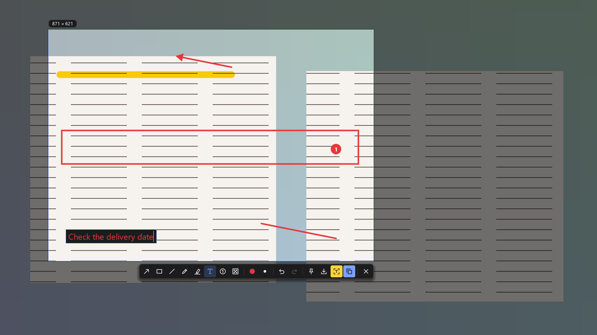
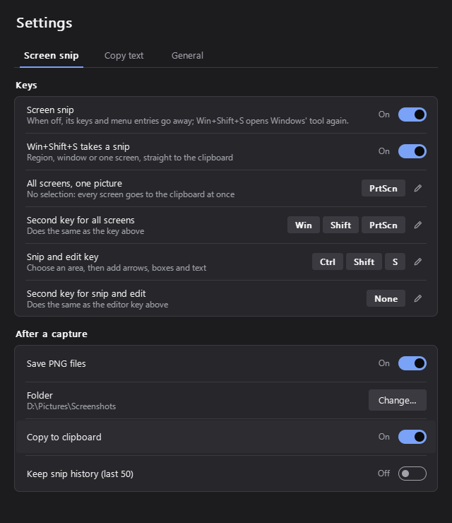
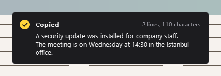
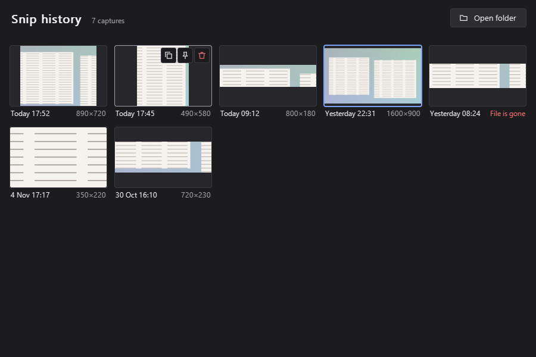

<p align="center"></p>

# snip

A small screenshot and text capture tool for Windows 11, written in Rust. It sits in the tray and
replaces the Win+Shift+S snip with something faster and a little more capable: freeze every monitor,
pick a region, a window or a whole screen, and the picture goes to the clipboard and to a PNG.

I wrote it because I wanted the Windows snip and a Lightshot-style editor in one program, without
an account, an updater or anything that talks to the network.

[Download the latest release](https://github.com/ydbilgin/snip/releases/latest) ·
[Features](#features) · [Keys](#keys) · [Privacy](#privacy) · [Build](#build) · [Türkçe](#türkçe)

> **Beta, unsigned.** The exe is not code-signed, so Windows SmartScreen may warn on first start
> ("More info" > "Run anyway"). Each release lists the SHA-256 of the exe so you can check it, or
> build it yourself from this source.

<p align="center">
  
</p>

## Features

- **Plain snip on Win+Shift+S.** All monitors freeze at once. Drag a region, click a window, or
  press Enter for the monitor under the cursor. Shift+click adds more windows or regions to one
  picture. The picture goes to the clipboard and to a PNG in your Screenshots folder.
- **All screens on PrtScn.** Every monitor in one picture, with no overlay and no selection.
- **Editor on Pause** (any key you choose): arrow, box, line, pen, highlighter, text, numbered
  steps, pixelate and blur, undo and redo. Then copy, save, save as, or pin the picture on top of
  the screen.
- **Copy text you cannot select on Win+Shift+T.** Drag over it and the text goes to the clipboard,
  read by the OCR that ships with Windows, on your PC. No picture is kept.
- **Short recordings on Ctrl+Shift+F9.** A silent MP4 of a region or window, plus a GIF made from it,
  for bug reports and chat.
- **History** of the last 50 captures, a 3 or 5 second delay, light and dark themes, English and
  Turkish.
- **One small exe.** No installer, no runtime to install, no network code.

<table>
  <tr>
    <td></td>
    <td><br><br>
        </td>
  </tr>
</table>

## Install

1. Download `snip-<version>-windows-x64.zip` from the
   [latest release](https://github.com/ydbilgin/snip/releases/latest) and unzip it.
2. Run `snip.exe`. A tray icon appears; Win+Shift+S now goes to snip. `snip quit` (or Quit in the
   tray menu) gives it back to Windows.
3. Optional: `install\install.ps1` copies the exe to `%LOCALAPPDATA%\Programs\snip`. In an elevated
   PowerShell, `install.ps1 -RunAtLogon` installs it to `%ProgramFiles%\snip` and starts it at logon
   through a scheduled task (see [Why it can run elevated](#why-it-can-run-elevated)).
   `install\uninstall.ps1` removes either.

Windows 11 on x64. Recording needs the Windows Media Feature Pack (present on most editions).
Text capture uses the OCR languages installed in Windows (Settings > Time & language > Language).

## Keys

| Key | What happens |
|---|---|
| **Win+Shift+S** | Plain snip: drag a region, click a window, Enter for the monitor under the cursor (Shift+Enter without its taskbar) |
| **Shift+click** / **Shift+drag** | Add a window or region to the same picture; Backspace removes the last one |
| Tap **Alt** or use the **wheel** | Pick a part inside a window (a panel, a button, a list) |
| **PrtScn**, **Win+Shift+PrtScn** | All screens as one picture |
| **Pause** | Snip and edit. In the editor: Ctrl+C copy, Ctrl+S save, Ctrl+Shift+S save as, Ctrl+P pin |
| Editor tools | A arrow, R box, L line, P pen, H highlighter, T text, N steps, B pixelate; 1/2/3 or the wheel for size; Ctrl+Z / Ctrl+Y |
| **Win+Shift+T** | Copy text: drag over it |
| **Ctrl+Shift+F9** | Start and stop a recording |
| **Arrow keys** | Move the cursor by 1 px (10 px with Shift) |
| **Esc** or right-click | Cancel |
| Hold **Alt** while dragging | Let a drag cross to another monitor |

Every key can be changed or turned off in Settings. Win+Shift+R stays with Snipping Tool.

## Privacy

- **No network.** snip has no network code; a test (`tests/no_network.rs`) fails if the sources or
  the dependency list ever gain anything network-shaped.
- **Files it writes:** your pictures (Screenshots folder, or the folder you choose); settings in
  `%APPDATA%\Laureth\snip\config.toml`; a step-timing log, state and the history thumbnails in
  `%LOCALAPPDATA%\Laureth\snip\`. The log holds sizes, times and the paths of saved files, never
  screen contents or clipboard text.
- **History:** the last 50 pictures (also ones that were only copied) and the last 20 copied texts
  are kept in that folder so you can find them again. Turn history off in Settings to keep nothing.
- **Clipboard:** snip writes pictures and text; it reads the clipboard only to confirm its own
  write and to avoid overwriting something newer.
- **Keyboard:** a low-level keyboard hook in snip's own process reacts only to its own keys. It does
  not record keystrokes.

## Why it can run elevated

A keyboard hook gets no key events while an elevated window (an administrator terminal, Task
Manager) has the focus, so Win+Shift+S would do nothing there. With `install.ps1 -RunAtLogon`, snip
starts at the highest level through a scheduled task, from `%ProgramFiles%\snip`, a folder only
administrators can change. Anything it opens (a folder, a saved picture) is started at the normal
level with the shell's own token. If you do not need the keys above elevated windows, just run the
exe; it works at the normal level.

## Build

You need Windows 11, Rust 1.97 or newer and the MSVC toolchain with the Windows SDK (for `rc.exe`;
set `RC` to its path if it is not on `PATH`).

```powershell
cargo build --release
cargo test
target\release\snip.exe --selftest   # headless checks, exit 0 = all passed
```

The core (geometry, editor, renderer, history, settings) has no Windows calls, so `cargo test` also
runs on Linux. Tests that open windows (`--selftest-overlay`, `--selftest-look`, ...) refuse the
visible desktop and must run on a separate hidden desktop.

For scripts: `snip status`, `snip snip [--edit] [--delay 3|5]`, `snip all`, `snip text`,
`snip record [--stop]`, `snip history`, `snip settings`, `snip --pin <png> <x> <y>` and `snip quit`
talk to the running tray process; `snip --help` lists them all.

## Contributing

Issues and pull requests are welcome; see [CONTRIBUTING.md](CONTRIBUTING.md). Security problems:
please report them privately, see [SECURITY.md](SECURITY.md).

## License

[MIT](LICENSE)

## Türkçe

snip, Windows 11 için küçük bir ekran alıntısı ve metin kopyalama aracı. Win+Shift+S ile tüm
ekranları dondurur; alan, pencere ya da tek ekran seçersiniz, resim panoya ve PNG olarak kaydedilir.
PrtScn tüm ekranları tek resim yapar, Pause düzenleyiciyi açar (ok, kutu, yazı, numaralı adım,
bulanıklaştırma), Win+Shift+T seçilemeyen metni Windows'un kendi OCR'ı ile panoya kopyalar,
Ctrl+Shift+F9 kısa sessiz kayıt alır. Ağ kodu yoktur; hiçbir şey internete gönderilmez. Arayüz
Türkçe ve İngilizce. İndirmek için [son sürüm](https://github.com/ydbilgin/snip/releases/latest);
exe imzasız bir beta olduğu için SmartScreen ilk açılışta uyarabilir.
